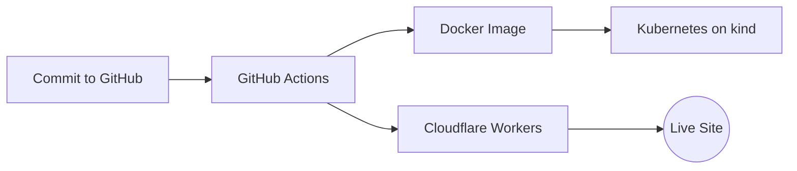

<a href="https://github.com/Jayasri-K-N">
  
</a>

<div align="center">

[](https://github.com/Jayasri-K-N)

</div>

---

## ☁️ About Me


```python
class JayasriK:

    Name     = "Jayasri K"
    Location = "Mannargudi, Tamil Nadu, India 🇮🇳"
    Degree   = "B.Tech – AI & Data Science (CGPA: 7.62)"
    College  = "St. Joseph's College of Engg & Tech, Thanjavur"
    Email    = "jayasrii1906@gmail.com"
    Goal     = "Cloud Engineer"

    cloud_devops       = ["Cloudflare Workers", "GitHub Actions", "Docker",
                          "Kubernetes", "CI/CD", "NGINX"]
    foundation         = ["Python", "HTML", "Machine Learning", "IBM Cognos"]
    currently_learning = ["Terraform", "Linux"]
    fun_fact           = "Took one hospital website from commit to live across 4 DevOps stages 🚀"

    def motto(self): return "Quick Learner. Self-Motivated. Build. Deploy. Repeat. ☁️"
```

<br clear="right"/>

---

## 🔄 From Commit to Live



---

## 🛠️ Tech Stack

<div align="center">

### Cloud & DevOps
[](https://skillicons.dev)

### Languages, OS & Tools
[](https://skillicons.dev)

</div>

---

## 📊 GitHub Activity

<div align="center">
  
</div>

<br/>

<div align="center">
  
</div>

---

## 🚀 Featured Projects

<div align="center">

| Project | Stack | What it does |
|:--------|:------|:-------------|
| ☁️ [**Cloud Hosting – MediCare Hospital**](https://medicare-hospital.jayasrii1906.workers.dev/) | Cloudflare Workers · GitHub | Static healthcare website deployed on Cloudflare Workers with source managed in GitHub ([GitHub Pages version](https://Jayasri-K-N.github.io/MediCare-Hospital/)) |
| 🔄 **CI/CD with GitHub Actions** | GitHub Actions · Wrangler Action · GitHub Secrets | Automated deployment on every push to `main`, with API token and account ID secured in GitHub Secrets |
| 🐳 **Dockerized Web Application** | Docker · NGINX Alpine · Docker Hub | Containerized the MediCare site, ran it locally with port mapping and published the image to Docker Hub |
| ⚙️ **Scalable Deployment on Kubernetes** | Kubernetes · kind · HPA · Probes | Deployments, Services and replicas with autoscaling, Liveness/Readiness probes, ConfigMaps, Secrets, rolling updates and rollbacks |
| 📊 [**IBM Cognos Analytics Dashboard**](https://Jayasri-K-N.github.io/IBM-Cognos-Dashboard/) | IBM Cognos Analytics | Interactive dashboards and reports that visualize business data for data-driven decisions |

</div>

---

## 🎯 Highlights

<div align="center">

| | What | Details |
|:---:|:-----|:--------|
| ☁️ | End-to-end DevOps pipeline | One application taken through hosting, CI/CD, containers and orchestration |
| 🏅 | Google Skills badges | Responsible AI, Prompt Design in Agent Platform, Introduction to Generative AI |
| 📊 | IBM Cognos Virtual Internship | Interactive dashboards and analytical reports (AdroIT Technologies) |
| 🗄️ | Big Data | Infosys Springboard – Big Data 101 and 301 |
| 🌱 | Continuous learner | Currently learning Terraform and Linux |

</div>

---

## 🎓 Education

<div align="center">

| 📚 Degree | 🏫 Institution | 📅 Score |
|:----------|:--------------|:-------:|
| B.Tech – Artificial Intelligence & Data Science | St. Joseph's College of Engineering & Technology, Thanjavur | CGPA: 7.62 |
| Higher Secondary Education (HSC) | St. Joseph's Girls Higher Secondary School, Mannargudi | 73% |

</div>

---

## 🌱 Currently Exploring

```
🏗️ Infrastructure as Code →  Terraform
🐧 Linux                  →  Command line · Administration basics
☁️ Cloud & DevOps         →  CI/CD · Containers · Kubernetes
🤖 AI & Data              →  Machine Learning · Generative AI · IBM Cognos
```

---

## 🤝 Let's Connect

<div align="center">

[](mailto:jayasrii1906@gmail.com)
[](https://github.com/Jayasri-K-N)
[](https://www.linkedin.com/in/jayasri-k-1n119)
[](#)

</div>

<br/>

<div align="center">
  <i>⚡ "Quick learner. Self-motivated. Commit, build, deploy."</i>
</div>

<br/>


